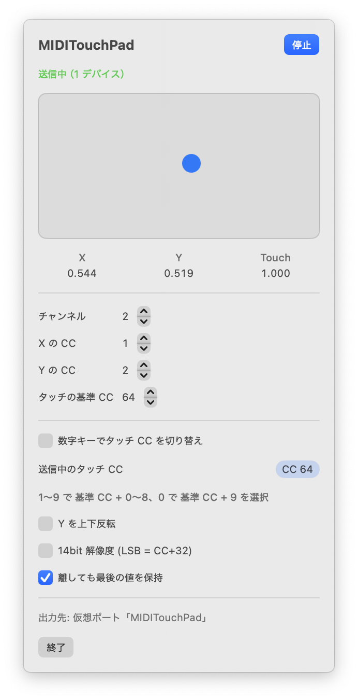

# MIDITouchPad

[日本語](README.md) | **English**

A menu bar app that sends where you touch your Mac's trackpad as MIDI CC messages.



The app's interface is in Japanese. The labels quoted below are translated in parentheses.

## Download

Get the latest `MIDITouchPad-x.y.z.zip` from [Releases](https://github.com/onomuta/MIDITouchPad/releases/latest),
unzip it, and move `MIDITouchPad.app` to `/Applications`. The app is signed with a Developer ID and
notarized by Apple, so it opens without a Gatekeeper warning. Requires macOS 13 or later.

## What it sends

| What | Default | Notes |
| --- | --- | --- |
| X position | CC 1 | Left 0 → right 127 |
| Y position | CC 2 | Near edge 0 → far edge 127 (can be inverted) |
| Touch on/off | CC 64 (base CC) | 127 while touching, 0 on release. The CC number can be switched with number keys |

Channel, CC numbers, Y inversion, 14-bit resolution, and whether to hold the last value after you lift
your finger can all be changed from the menu and are saved in `UserDefaults`.

Output goes to a virtual MIDI source named **MIDITouchPad** that the app publishes itself. No IAC Driver
setup is needed; it simply appears in your DAW's list of MIDI inputs.

## Switching the touch CC with number keys

Turn on the toggle "数字キーでタッチ CC を切り替え" (Switch touch CC with number keys) in the menu. The CC
number used for the touch on/off message then follows the **last number key you pressed**, even while
another app such as your DAW is in front.

| Key | Touch CC (with base CC 64) |
| --- | --- |
| `1` | CC 64 |
| `2` | CC 65 |
| `3` | CC 66 |
| … | … |
| `9` | CC 72 |
| `0` | CC 73 |

- The CC is the base CC (default 64) plus 0–8 for `1`–`9`, or plus 9 for `0`. Values above 127 are clamped to 127.
- Keypad digits work the same way. Keys pressed together with `⌘` are ignored.
- If you switch while a finger is on the trackpad, the app sends 0 on the old CC and 127 on the new one, so no CC is left stuck on.
- The menu shows the CC currently in use under "送信中のタッチ CC" (Touch CC being sent).
- The toggle is off by default, and the selection returns to the base CC every time the app starts.
- Every digit you type in any app changes the selection, so turn the toggle off while typing text or numbers.

### Granting Input Monitoring

To catch keys while another app is in front, MIDITouchPad needs permission under System Settings →
Privacy & Security → **Input Monitoring**. Without it, number keys only work while the menu panel is open.

1. Turn the toggle on. A permission dialog appears; choose to open System Settings and switch MIDITouchPad on.
2. When the panel shows the green message "他のアプリが前面でも有効です" (Active even when other apps are in front), it is working. If it does not change after granting permission, quit and reopen the app.
3. If MIDITouchPad is not in the list, add `MIDITouchPad.app` with the "+" button under the list.

### Permission granted but the panel is not green

If you previously granted permission to a build with a different signature (for example a self-built,
ad-hoc signed copy), the stale permission can remain and no longer matches the current app, so macOS
treats it as not granted. Remove the stale entry, then grant permission again.

```sh
tccutil reset ListenEvent local.miditouchpad
```

Then reopen the app and switch the toggle off and on.

## Building from source

```sh
./build.sh
open build/MIDITouchPad.app
```

This produces an ad-hoc signed app, which is enough to run on your own Mac. To sign with a Developer ID
(with Hardened Runtime), pass your certificate name:

```sh
SIGN_IDENTITY="Developer ID Application: Your Name (TEAMID)" ./build.sh
```

The app does not appear in the Dock. A hand icon appears in the menu bar and the app starts sending
immediately. Click the icon to see the current X / Y / touch state and the settings.

The app icon is drawn by `tools/make_icon.swift`; run `swift tools/make_icon.swift .` to regenerate it.

## How it works and limitations

- Touch positions are read by loading the private framework `MultitouchSupport` with `dlopen`. It has no
  headers, so the app depends on the memory layout of `MTTouch`, and an OS update may break it.
- Because it uses a private framework, the App Sandbox cannot be enabled and the app cannot be
  distributed on the Mac App Store. The released build is signed with a Developer ID and notarized by Apple.
- Reading is passive, so the trackpad keeps controlling the cursor as usual. Be aware that clicks and
  swipes can trigger by accident while you play.
- When several fingers touch the trackpad, only the first finger that touched is tracked.
- Catching number keys system-wide requires the Input Monitoring permission (see above).

## License

MIT License (see [LICENSE](LICENSE)).
